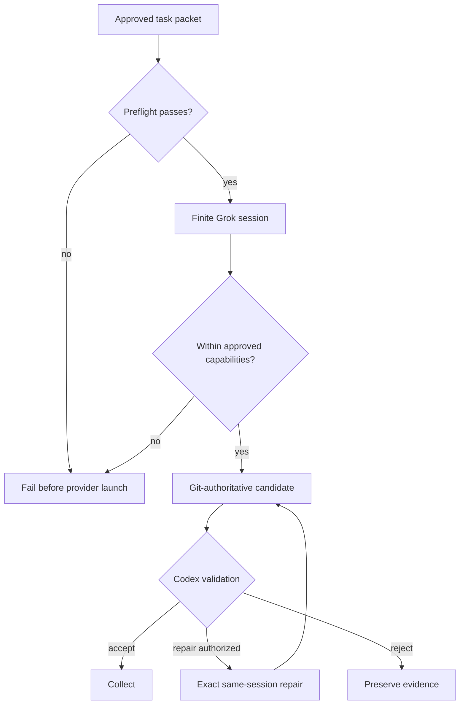
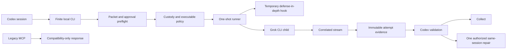
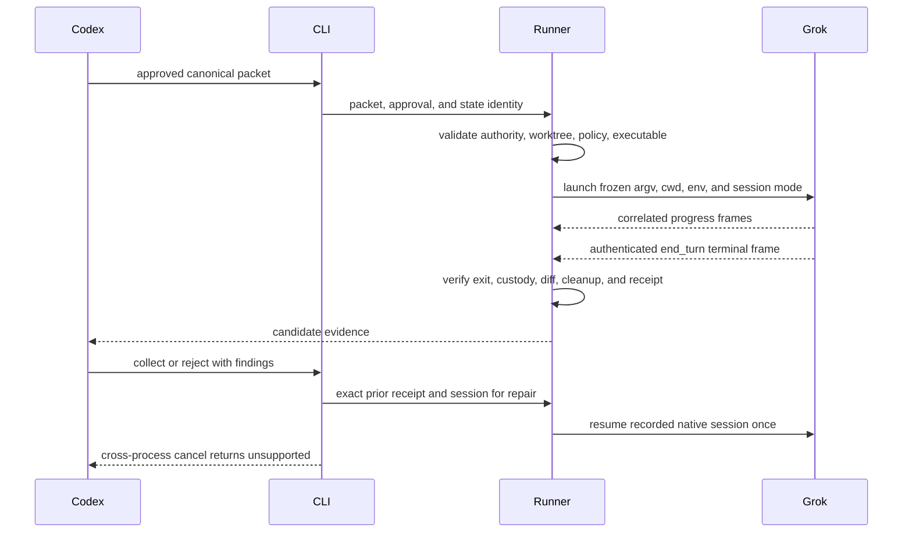
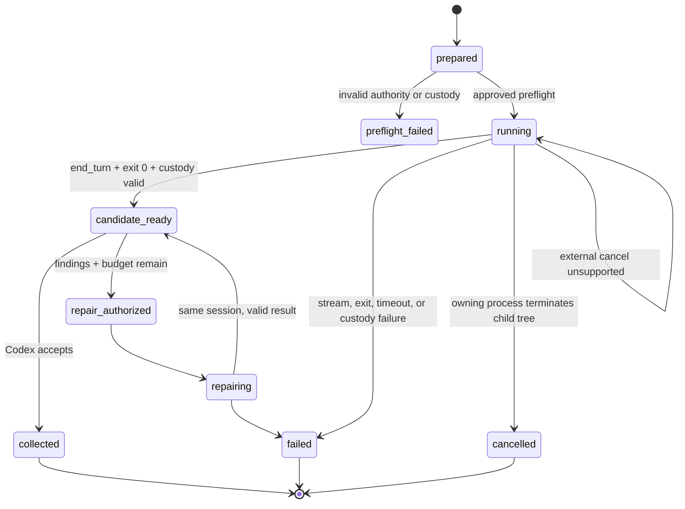
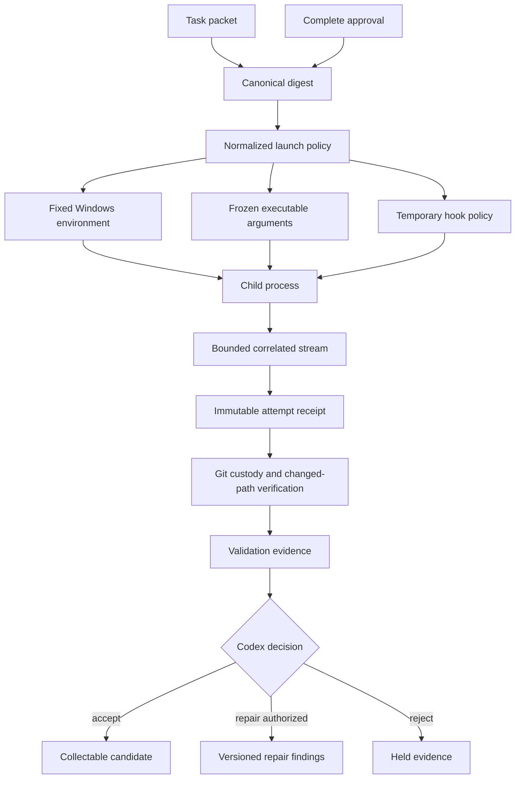
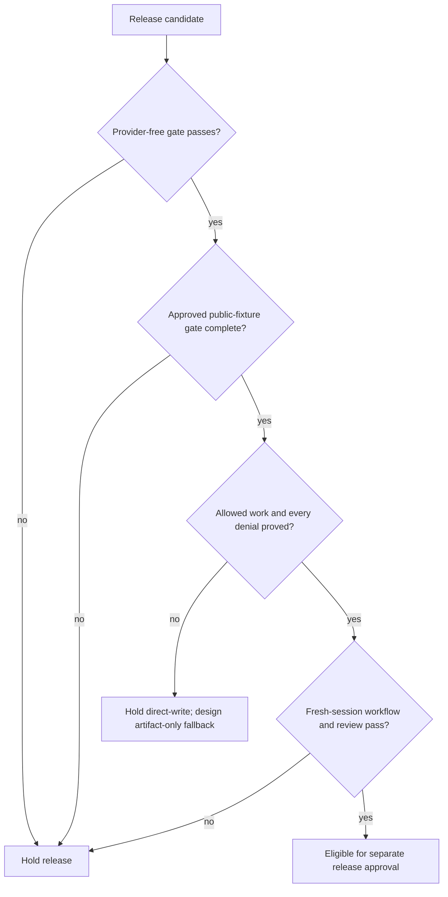
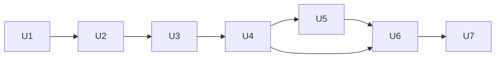

# Grok Build Engineer 0.5.1 Hardening - Plan

## Goal Capsule

- **Objective:** Independent Codex sessions can delegate bounded implementation and same-session repair work to Grok Build with reliable Windows behavior, honest trusted-host guarantees, and evidence sufficient for Codex acceptance.
- **Means:** Harden the finite one-shot CLI and prove its permission, custody, lifecycle, packaging, and recovery boundaries before releasing version 0.5.1.
- **Product authority:** Codex owns task approval, repository custody, validation, acceptance, and delivery; Grok remains the bounded implementation worker; the human owner retains provider, publication, deployment, and private-project authority.
- **Open blockers:** The candidate cannot be released or used on a private project until the corrected public-fixture release gate proves allowed work, denied behavior, same-session repair, cleanup, and collection.

---

## Product Contract

### Summary

Release version 0.5.1 as a single CLI-first Codex-to-Grok engineering product whose runtime claims match behavior on the trusted Windows host.
Preserve the successful one-shot implementation and repair lifecycle while closing the adversarial-review gaps that can bypass scope, misreport completion, or confuse independent Codex sessions.

### Problem Frame

The current candidate completed one real implementation and one exact same-session repair, but that proof did not establish that its new tool guard governed every Grok action.
Independent review found that the guard envelope conflicts with Grok 1.0.5 documentation, command and path patterns admit broader behavior than intended, linked-worktree isolation is not required, and cross-process cancellation is advertised but unavailable.
The passing suite also mixes the live CLI product with a retired ACP/job-host stack, so its headline count overstates release-path coverage.

### Actors

- A1. **Human owner:** Approves exact provider disclosure, cost, external effects, and later publication or private-project use.
- A2. **Codex session:** Prepares the task, invokes the CLI, verifies custody and tests, issues repair findings, and accepts or rejects the candidate.
- A3. **Grok Build:** Performs one bounded implementation or one authorized same-session repair.
- A4. **Local runner:** Enforces the approved process, worktree, command, path, environment, timeout, session, receipt, and cleanup contract.
- A5. **Git worktree:** Contains the isolated candidate and supplies authoritative source and diff evidence.

### Key Decisions

- **Preserve the finite one-shot CLI** (session-settled: user-approved — chosen over a task-local supervisor: it retains the proven implementation path without recreating the persistent controller failure mode). Governs R1, R2, R14.
- **Treat hooks as defense-in-depth** (session-settled: user-approved — chosen over presenting a fail-open Grok hook as the primary security boundary: the trusted-host product must claim only what it can prove). Governs R4, R5, R6, R8.
- **Require an isolated linked worktree** (session-settled: user-approved — chosen over convention-only isolation: independent Codex sessions must not be able to point Grok at a primary checkout). Governs R3, R7.
- **Keep artifact-only delegation as a fallback** (session-settled: user-approved — chosen over forcing release when direct-write enforcement cannot be proved: sensitive work needs a lower-authority escape hatch). Governs R16.
- **Keep adversarial review separate from runtime hardening** (session-settled: user-approved — chosen over bundling the reviewer skill into 0.5.1: release safety is one coherent work unit). Governs R18.

### Requirements

**Runtime identity and lifecycle**

- R1. The live product uses the finite CLI for prepare, submit, status, repair, collect, and cancellation behavior without depending on the legacy ACP controller.
- R2. Every provider run binds one approved task packet to one Grok executable identity, model, working directory, native session, implementation budget, and repair budget.
- R3. An implementation run starts only in a clean linked worktree that is distinct from its source repository and state root; repair resumes only the exact accepted candidate worktree and session.
- R4. Candidate publication requires an authenticated terminal completion representing `end_turn`, a successful child exit, bounded stream correlation, and unchanged Git custody.
- R5. Cancellation either terminates the attested task process tree and records a truthful terminal receipt or returns a stable unsupported result without claiming cancellation.
- R6. Temporary controller-owned policy and hook artifacts are removed after success, failure, timeout, cancellation, inspection error, or detected tampering without altering unrelated Grok sessions.

**Permission and custody enforcement**

- R7. Git-authoritative verification rejects staged state, primary-checkout use, worktree/source mismatch, changed paths outside the approved path segments, and candidate drift before collection.
- R8. Grok receives only exact approved tool, executable, argument, path, environment, network, and timeout capabilities; wildcard patterns cannot widen them beyond their stated boundary.
- R9. An empty caller environment allowlist still supplies the fixed Windows variables required to launch Grok and approved validation commands without forwarding secret-shaped user variables.
- R10. Competing input-rewriting hooks or an undiscoverable controller guard prevent provider launch; passive unrelated hooks remain unaffected.
- R11. A failed or malformed Grok hook never becomes the sole reason an external effect is considered prevented.

**Authority and evidence**

- R12. The complete approval object is semantically bound to the canonical task packet, including issuer statement, issue and expiry times, source, worktree, model, policies, and repair findings.
- R13. Immutable implementation and repair receipts preserve request identity, native session continuity, custody and diff digests, validation evidence, outcome, and bounded provider usage.
- R14. Status, repair, collection, and cancellation consume the exact packet state root and task identity and return stable machine-readable results and exit codes.

**Product surface and release**

- R15. A fresh Codex session discovers one CLI-first lifecycle with valid examples, consistent version metadata, actionable failure feedback, upgrade instructions, and rollback instructions.
- R16. If direct-write enforcement cannot pass the public-fixture gate, version 0.5.1 is held and the next design uses artifact-only patch delegation rather than weakening the acceptance boundary.
- R17. The release gate distinguishes current CLI tests from legacy compatibility tests and cannot pass by running only mocked child or retired ACP coverage.
- R18. The adversarial-reviewer skill, private-project pilot, publication, and deployment remain separately planned and separately authorized.

### Key Flows

- F1. **Implementation lifecycle**
  - **Trigger:** A1 approves the exact packet prepared by A2.
  - **Actors:** A1, A2, A3, A4, A5.
  - **Steps:** A4 verifies authority and isolation; A3 performs allowed work; A4 records a candidate; A2 independently validates and accepts or rejects it.
  - **Outcome:** A collectable candidate exists only when R2-R4 and R7-R14 hold.
- F2. **Same-session repair**
  - **Trigger:** A2 rejects a candidate with versioned findings and remaining repair authority.
  - **Actors:** A2, A3, A4, A5.
  - **Steps:** A4 binds the findings to the prior receipt and session; A3 resumes that session once; A2 revalidates the resulting candidate.
  - **Outcome:** Repair continuity is proved without granting a second independent implementation attempt.
- F3. **Denied action**
  - **Trigger:** A3 requests a command, write, tool, or path outside R8.
  - **Actors:** A3, A4.
  - **Steps:** The executable permission layer refuses the request; the guard supplies a second decision when healthy; A4 rejects any resulting custody violation.
  - **Outcome:** No candidate can be accepted from an out-of-contract run.
- F4. **Cancellation and cleanup**
  - **Trigger:** A2 requests cancellation or A4 reaches a timeout or protocol failure.
  - **Actors:** A2, A4.
  - **Steps:** A4 terminates the attested process tree or reports unsupported behavior; it records the outcome and removes controller-owned temporary artifacts.
  - **Outcome:** The operator receives truthful state and no controller hook remains active.

### Acceptance Examples

- AE1. **Covers R3, R7.** Given a packet whose worktree equals the primary repository, when submit runs, then it fails before Grok launches and records no provider attempt.
- AE2. **Covers R8.** Given `src/**`, when a tool targets `src2/file.mjs`, then the request and any resulting candidate are rejected as out of scope.
- AE3. **Covers R8.** Given a broad command pattern, when Grok requests `git -C <other-root> push` or an indirect publication command, then the executable permission contract denies it.
- AE4. **Covers R4.** Given a zero exit and a terminal event with `max_turns` or another non-`end_turn` reason, when the run settles, then no candidate is published.
- AE5. **Covers R5, R6.** Given a running task, when another CLI process requests cancellation, then the process tree ends and the controller hook is absent; otherwise the CLI reports cancellation as unsupported without a false terminal claim.
- AE6. **Covers R10, R11.** Given a malformed guard event, guard crash, or competing input-rewriting hook, when preflight or execution evaluates it, then the run fails closed at a primary enforcement boundary and does not rely on Grok hook failure behavior.
- AE7. **Covers R12.** Given an approval file whose expiry or authorization statement differs from the approved packet, when submit runs, then it is rejected before provider launch.
- AE8. **Covers R13.** Given one accepted implementation candidate and approved repair findings, when repair runs, then it resumes the same native session exactly once and produces a separately immutable receipt.
- AE9. **Covers R15, R17.** Given a fresh Codex session and the released plugin, when it follows the documented lifecycle against the public fixture, then it completes without hidden commands or legacy MCP routing and emits diagnosable evidence.
- AE10. **Covers R16.** Given that a prohibited real Grok action is not demonstrably denied, when release acceptance is evaluated, then 0.5.1 remains unpublished and direct-write private-project use remains blocked.

### Success Criteria

- The focused CLI release gate passes on supported Windows Node 20 and 22 environments.
- A real public-fixture run proves an allowed implementation, one exact same-session repair, prohibited path denial, prohibited command denial, independent validation, collection, and clean temporary-hook removal.
- A fresh Codex session completes the documented workflow without consulting prior conversation history or the retired MCP lifecycle.
- A fresh-session adversarial review finds no unresolved Critical or High release blocker; every residual risk is labeled as trusted-host, deferred, or outside product authority.

### Scope Boundaries

- OS-level sandboxing and hard provider-cost enforcement are not promised by version 0.5.1.
- Push, merge, publication, deployment, credentials, connected-system mutation, and customer action remain outside Grok authority.
- A private-project pilot begins only after the public-fixture release gate and requires separate disclosure and provider approval.
- The adversarial-reviewer skill is the next separately planned capability, not part of this release.
- The legacy ACP/job-host implementation may remain as isolated compatibility evidence, but it cannot present a competing product lifecycle.

<!-- ce-section: work-relationships -->
### How This Work Fits Together

This plan owns the 0.5.1 runtime hardening and release gate; the broader breakdown remains contextual rather than a committed roadmap.

- **Enables:** A later `grok-adversarial-reviewer` skill can reuse the validated CLI, disclosure, receipt, and evidence contracts.
- **Enables:** A bounded non-production private-project pilot can begin after release acceptance and separate authorization.
- **Can proceed independently of:** Packaging the reviewer skill and designing any future OS-sandboxed execution profile.
- **Still to decide later:** Whether artifact-only delegation becomes an optional high-assurance mode after 0.5.1 or only the fallback if direct-write proof fails.

### Dependencies and Assumptions

- Grok Build 1.0.5 remains the supported host baseline for the first release gate.
- Grok hooks are fail-open on crashes, malformed output, and timeouts; primary guarantees therefore cannot depend on hook health alone.
- The trusted Windows host and authenticated local Grok installation are operator-managed dependencies.
- Provider calls, publication, installation, and private-repository disclosure require approvals outside this plan.

### Sources and Research

- `src/one-shot-runner.mjs` — finite lifecycle, custody, stream handling, cancellation, and candidate publication.
- `src/pretool-guard.mjs` and `src/pretool-overlay.mjs` — temporary guard policy, event handling, discovery, and cleanup.
- `src/task-policy.mjs` and `src/headless-session.mjs` — path, command, environment, and Grok permission contracts.
- `src/worktree-custody.mjs` — existing linked-worktree and Windows custody controls available for reuse.
- `.codex-plugin/plugin.json`, `.mcp.json`, `README.md`, and `skills/grok-build-engineer/SKILL.md` — operator-facing product and compatibility surfaces.

---

## Planning Contract

This enrichment preserves the Product Contract, stable `R1-R18`, `F1-F4`, and `AE1-AE10` meanings without broadening Grok authority.

- **Change:** Harden the existing finite CLI-first product and its release gate; do not replace it with a resident controller.
- **Target:** The standalone Grok Build Engineer release worktree; all implementation paths below are repository-relative.
- **Execution posture:** Provider-free implementation and verification first, followed by a separately approved public-fixture behavioral gate.
- **Supported baseline:** Trusted Windows host, Node.js 20 and 22, and Grok Build 1.0.5.
- **Authority boundary:** Implementation does not authorize a provider call, installation, publication, deployment, push, merge, private-project disclosure, or customer action.

### Key Technical Decisions

1. **KTD1 — Preserve the finite one-shot CLI** (session-settled: user-approved — chosen over a task-local supervisor: it retains the proven implementation path without recreating the persistent-controller failure mode). Implements R1, R2, R14.
2. **KTD2 — Make hooks defense-in-depth** (session-settled: user-approved — chosen over hook-primary enforcement: executable policy, process custody, and Git verification remain authoritative when Grok hooks fail open). Implements R4-R6, R8, R10, R11.
3. **KTD3 — Require an isolated linked worktree** (session-settled: user-approved — chosen over convention-only isolation: independent Codex sessions must not be able to target a primary checkout). Implements R3, R7.
4. **KTD4 — Keep artifact-only delegation as the fallback design** (session-settled: user-approved — chosen over weakening acceptance when direct-write proof fails: version 0.5.1 direct-write remains held until the release gate passes). Implements R16.
5. **KTD5 — Keep adversarial review separate** (session-settled: user-approved — chosen over bundling the reviewer skill into runtime hardening: release safety remains one coherent work unit). Implements R18.
6. **KTD6 — Accept only authenticated `end_turn` completion.** Candidate publication requires correlated streaming output, the expected native session, a zero child exit, and terminal `stopReason === "end_turn"`. Implements R4, R13.
7. **KTD7 — Report cross-process cancellation as unsupported in 0.5.1.** The owning process may enforce its timeout and terminate its child tree; a different CLI process returns a stable `unsupported` result and never writes a false cancellation receipt. A persistent IPC or supervisor design is deferred. Implements R5, R14.
8. **KTD8 — Present one CLI-first product surface.** The plugin manifest and skill route implementation through the local CLI. Legacy MCP remains isolated compatibility evidence and cannot spawn, proxy, resume, or advertise a competing lifecycle. Implements R1, R15, R17.
9. **KTD9 — Make direct-write eligibility evidence-bound.** Direct-write remains unavailable for private-project use until the complete public-fixture gate proves allowed work, denied behavior, repair continuity, independent validation, collection, and cleanup. Implements R15-R17.
10. **KTD10 — Fail before launch on missing primary proof.** Invalid approval, custody, executable identity, environment, or capability policy stops the run; missing direct-write release evidence holds release rather than silently switching modes. Implements R2, R3, R8-R12, R16.

## High-Level Technical Design

These sketches describe responsibilities and evidence flow, not required code structure.

### Architecture

### Submission and repair protocol

### Lifecycle state

### Evidence data flow

### Release decision

## Implementation Units

### U1. Canonical authority and linked-worktree custody

- **Files:** `src/contracts.mjs`, `src/authority-safety.mjs`, `src/worktree-custody.mjs`, `test/contracts.test.mjs`, `test/worktree-custody.test.mjs`
- **Requirements:** R2, R3, R7, R12-R14; F1-F3; AE1, AE7, AE8; KTD3, KTD10.
- **Dependencies:** None.
- **Approach:** Canonicalize and digest every approval field; reject repository/worktree equality, non-linked worktrees, state-root overlap, staged state, dirty baselines, and source drift; bind repair to one prior candidate receipt and native session.
- **Execution note:** Reuse the existing worktree-custody primitives and never derive authority from caller-provided command, branch, working directory, or environment values.
- **Test scenarios:**
  - **Happy:** A complete unexpired approval for a clean linked worktree admits one implementation attempt and persists its immutable identity.
  - **Edge:** Case, separator, junction, and path-alias variants still prove that repository, worktree, and state roots are distinct.
  - **Error:** Altering the issuer statement, expiry, source SHA, worktree, model, or repair findings rejects the request before child spawn.
  - **Integration:** Repair accepts the exact prior candidate receipt and session once, while a different receipt, worktree, or session is rejected.

### U2. Exact capability policy and hook normalization

- **Files:** `src/task-policy.mjs`, `src/pretool-guard.mjs`, `src/pretool-overlay.mjs`, `src/headless-session.mjs`, `test/task-policy.test.mjs`, `test/pretool-guard.test.mjs`, `test/headless-session.test.mjs`
- **Requirements:** R8-R11; F3; AE2, AE3, AE6; KTD2, KTD10.
- **Dependencies:** U1.
- **Approach:** Centralize segment-aware path decisions and exact command-token decisions; normalize documented `pre_tool_use` input; construct the child environment from fixed Windows launch variables plus explicitly approved non-secret keys; fail preflight for competing input-rewriting hooks or an undiscoverable controller guard.
- **Execution note:** Remove wildcard command expansion and duplicate path/command decision ownership. Hook configuration may retain Grok's documented event label while runtime normalization owns the input envelope.
- **Test scenarios:**
  - **Happy:** An approved command writes only beneath `src/` and receives the fixed launch environment without secret-shaped variables.
  - **Edge:** `src2/`, mixed separators, case variants, quoted arguments, and executable aliases do not match an approved `src/` or command boundary.
  - **Error:** Shell wrappers, remote Git, publication, deployment, malformed guard input, or guard discovery failure stops the run before an acceptable candidate exists.
  - **Integration:** A competing input-rewriting hook blocks provider launch while passive unrelated hooks remain unchanged and controller artifacts are cleaned up.

### U3. Finite process transport, terminal proof, and truthful cancellation

- **Files:** `src/headless-session.mjs`, `src/one-shot-runner.mjs`, `src/lifecycle.mjs`, `test/headless-session.test.mjs`, `test/one-shot-runner.test.mjs`, `test/fake-acp-agent.mjs`
- **Requirements:** R1, R4-R6, R13, R14; F1, F2, F4; AE4, AE5, AE8; KTD1, KTD6, KTD7.
- **Dependencies:** U1, U2.
- **Approach:** Freeze executable identity, model, working directory, output mode, request ID, and resume session; accept bounded correlated frames followed by exactly one authenticated `end_turn`; classify EOF, invalid framing, overflow, timeout, nonzero exit, and post-terminal data as failure; keep owning-process timeout/termination and return `unsupported` for cross-process cancellation.
- **Execution note:** Use a fake finite child for provider-free protocol proof and do not infer live Grok behavior from legacy ACP tests.
- **Test scenarios:**
  - **Happy:** Correlated progress followed by the expected session's `end_turn` and exit zero produces candidate evidence; repair resumes that session once.
  - **Edge:** Delayed frames, duplicate terminal frames, unknown request IDs, and bounded stderr remain deterministic and cannot publish twice.
  - **Error:** `max_turns`, early EOF, post-terminal output, stream overflow, timeout, nonzero exit, and failed child-tree termination never publish a candidate.
  - **Integration:** Repeated Windows runs leave no orphan process, open handle, stale hook, lock, or falsely cancelled task; another process receives stable `unsupported` for cancel.

### U4. State, receipts, candidate publication, and CLI contract

- **Files:** `src/job-store.mjs`, `src/job-service.mjs`, `src/cli-contract.mjs`, `scripts/grok-delegate.mjs`, `test/job-store.test.mjs`, `test/job-service.test.mjs`, `test/cli-contract.test.mjs`, `test/integration-lifecycle.test.mjs`
- **Requirements:** R1, R7, R13-R15; F1-F4; AE5, AE8, AE9; KTD1, KTD6-KTD8.
- **Dependencies:** U1-U3.
- **Approach:** Make every operation consume the exact state root and task identity; publish only after stream, exit, receipt, custody, changed-path, and validation gates pass; preserve implementation evidence when repair fails; return deterministic JSON, stable states and exit codes, and redacted bounded diagnostics.
- **Execution note:** Receipts are append-only evidence; repair must not replace or weaken the implementation attempt record.
- **Test scenarios:**
  - **Happy:** A fresh process can inspect, repair, validate, and collect a prior candidate using only documented task and state identities.
  - **Edge:** Repeated status and collect calls are idempotent; repeated cancel returns the same truthful unsupported or terminal result.
  - **Error:** Wrong state root, mismatched task identity, failed validation, or failed repair leaves prior receipts intact and the candidate uncollectable.
  - **Integration:** Prepare, submit, status, repair, and collect complete through the CLI without an MCP host or prior conversation context.

### U5. CLI-first packaging and legacy compatibility boundary

- **Files:** `.codex-plugin/plugin.json`, `.mcp.json`, `package.json`, `src/build-mcp.mjs`, `src/mcp-server.mjs`, `mcp/server.mjs`, `test/plugin-manifest.test.mjs`, `test/mcp-server.test.mjs`
- **Requirements:** R1, R14, R15, R17; F1, F4; AE9; KTD8.
- **Dependencies:** U4.
- **Approach:** Align all version metadata to 0.5.1; remove MCP from the default plugin lifecycle surface; retain compatibility code and tests only where they cannot launch, proxy, resume, or advertise an implementation job; make the skill and CLI the single discoverable route.
- **Execution note:** If host packaging requires an MCP declaration, expose only deterministic compatibility guidance and prove it has no child-process path.
- **Test scenarios:**
  - **Happy:** A fresh plugin inspection finds the 0.5.1 skill and documented CLI lifecycle with consistent metadata.
  - **Edge:** Generated bundle metadata and compatibility files remain version-consistent without becoming the default route.
  - **Error:** Any manifest or generated bundle that advertises legacy submit or repair fails verification.
  - **Integration:** Legacy MCP lifecycle calls return deterministic migration guidance and create no process, session, task state, or candidate.

### U6. Operator documentation and synthetic-fixture harness

- **Files:** `README.md`, `skills/grok-build-engineer/SKILL.md`, `examples/task-packet.template.json`, `examples/job-request.example.json`, `examples/capability-profiles.example.json`, `scripts/prepare-task-packet.mjs`, `test/fixtures/live-synthetic/README.md`, `test/cli-contract.test.mjs`
- **Requirements:** R1, R8, R9, R15, R16, R18; F1-F4; AE9, AE10; KTD4, KTD5, KTD7-KTD10.
- **Dependencies:** U4, U5.
- **Approach:** Document one prepare/approve/submit/status/repair/collect lifecycle; state the trusted-host, provider-cost, cancellation, hook, and external-effect limits; validate every example against the current schema; define the public-fixture evidence bundle and the artifact-only follow-up trigger without claiming artifact-only is implemented in 0.5.1.
- **Execution note:** Examples contain no credentials or copied provider commands, and documentation must say cross-process cancel is unsupported rather than eventual.
- **Test scenarios:**
  - **Happy:** A fresh Codex session validates the examples and completes the provider-free workflow using only the skill and README.
  - **Edge:** An empty caller environment allowlist still yields the fixed Windows launch variables and no secret-shaped values.
  - **Error:** Documentation or examples requesting direct-write private use without current fixture proof fail their contract checks.
  - **Integration:** The synthetic fixture can be cloned into an isolated linked worktree and prepared without consulting previous session context.

### U7. Provider-free and live release gates

- **Files:** `scripts/run-tests.mjs`, `package.json`, `.github/workflows/provider-free-verify.yml`, `test/release-gate.test.mjs`, `test/integration-lifecycle.test.mjs`, `docs/release/grok-build-engineer-051-release-gate.md`
- **Requirements:** R4, R10-R18; F1-F4; AE4-AE10; all Success Criteria; KTD4-KTD10.
- **Dependencies:** U1-U6.
- **Approach:** Separate current CLI contract/lifecycle coverage from legacy compatibility coverage; fail the release command when only mocked-child or retired-ACP coverage ran; record provider-free contract, policy, lifecycle, restart, cleanup, receipt, and manifest evidence; define a separately approved live gate for allowed work, prohibited path and command denial, exact same-session repair, validation, collection, cleanup, and fresh-session review.
- **Execution note:** Implementation may create the gate and provider-free evidence, but no live provider run, release, installation, or private-project use occurs without its separate authorization.
- **Test scenarios:**
  - **Happy:** All current CLI suites pass on Node.js 20 and 22 and the report labels compatibility tests separately.
  - **Edge:** Passing legacy tests or mocked-child tests alone cannot satisfy the release decision.
  - **Error:** Missing, stale, incomplete, or contradictory live evidence holds direct-write release and triggers the artifact-only design fallback.
  - **Integration:** A separately approved public-fixture run proves allowed implementation, denied path, denied command, same-session repair, independent validation, collection, cleanup, and a fresh-session adversarial review with no unresolved Critical or High blocker.

### Sequencing

Complete U1-U4 before changing the advertised product surface. Complete U5-U6 before executing U7 so the fresh-session proof evaluates the release candidate users would actually receive.

## Risks and Alternatives

- **Grok hook protocol drift:** Normalize the documented envelope and retain executable policy, process custody, and Git verification as primary authority.
- **Direct-write denial cannot be proved:** Hold direct-write release and plan artifact-only patch delegation; do not weaken the gate.
- **Cross-process cancellation remains unavailable:** Report `unsupported` truthfully and defer an IPC or supervisor design rather than killing an unattested PID.
- **Windows environment requirements vary:** Maintain a small explicit fixed set and test supported Node.js and Grok baselines with empty caller allowlists.
- **Legacy MCP creates operator confusion:** Remove it from default discovery and prove compatibility code cannot create or resume work.
- **Provider evidence is unavailable:** Report the candidate as provider-free verified only; do not claim behavioral or private-project readiness.

## Verification Contract

| Gate | Required evidence | Pass condition |
| --- | --- | --- |
| Authority and custody | Packet, approval, state-root, and linked-worktree tests | Every altered binding fails before spawn; valid attempts preserve immutable lineage |
| Capability policy | Path, command, environment, executable, and hook tests | Prefix collisions, wrappers, secret inheritance, competing hooks, and malformed guard input cannot yield an acceptable candidate |
| Finite lifecycle | Fake-child Windows runs on Node.js 20 and 22 | Only expected-session `end_turn` plus exit zero and valid custody publishes a candidate |
| Cancellation and cleanup | Owning-process timeout/termination and external-process cancel tests | Child-tree outcomes are truthful, external cancel is stable `unsupported`, and controller artifacts are removed |
| CLI and compatibility | CLI, manifest, generated bundle, and MCP tests | CLI is the sole implementation route and compatibility code cannot spawn or resume work |
| Fresh-session usability | Independent provider-free walkthrough | No hidden command, copied transcript, prior conversation, or retired lifecycle is required |
| Public-fixture behavior | Separately approved immutable evidence bundle | Allowed work, both denial classes, repair, validation, collection, cleanup, and fresh review all pass |
| Release decision | Versioned release-gate report | Direct-write remains held unless every provider-free and live condition is current and complete |

### Verification Commands

- `npm run build` — syntax-check sources, regenerate compatibility artifacts, and validate the bundled entry points.
- `npm run test` — run provider-free current CLI and separately labeled compatibility suites.
- `npm run verify` — run the full provider-free build and test gate.
- The live public-fixture command is recorded in the release-gate document and executed only after separate packet approval; it is not part of unattended `npm run verify`.

## Definition of Done

- The finite CLI is the only implementation and repair lifecycle advertised to Codex.
- Approval, linked-worktree custody, executable identity, exact path and command policy, fixed environment, and immutable attempt evidence fail closed before collection.
- Candidate publication requires the expected session's correlated `end_turn`, successful child exit, valid Git custody, allowed changed paths, and approved validation evidence.
- Same-session repair is bound to one prior candidate and one remaining repair budget.
- Owning-process timeout and termination are bounded and truthful; cross-process cancel returns stable `unsupported` without false state.
- Controller-owned hook and policy artifacts are removed on every terminal path without changing unrelated Grok sessions.
- Version 0.5.1 metadata, skill instructions, examples, upgrade guidance, rollback guidance, and compatibility behavior describe one CLI-first product.
- Provider-free Windows tests distinguish current CLI evidence from legacy compatibility evidence and leave no orphan process, stale state, or lock.
- Direct-write remains held until the separately approved public-fixture gate is complete; failure triggers the artifact-only follow-up instead of weaker enforcement.
- No unresolved Critical or High blocker remains after the fresh-session release review.
- Provider calls, installation, publication, deployment, push, merge, private-project disclosure, and customer action remain separately authorized.
